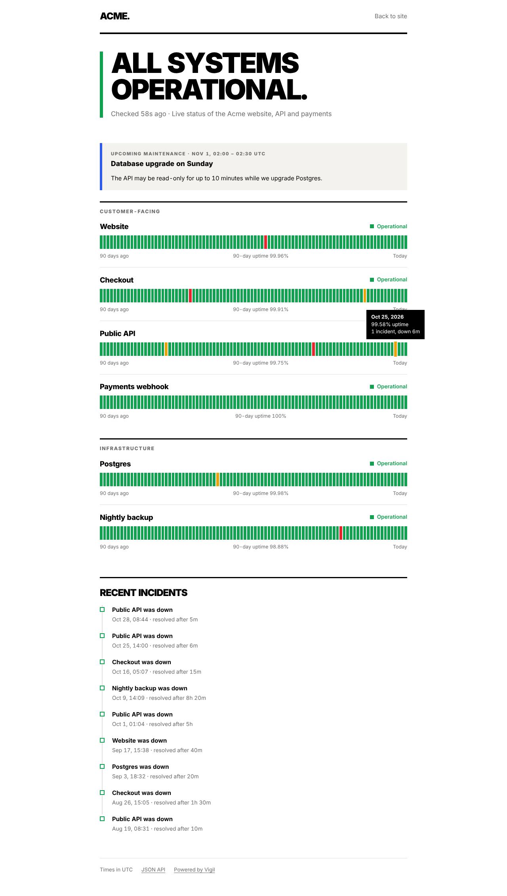
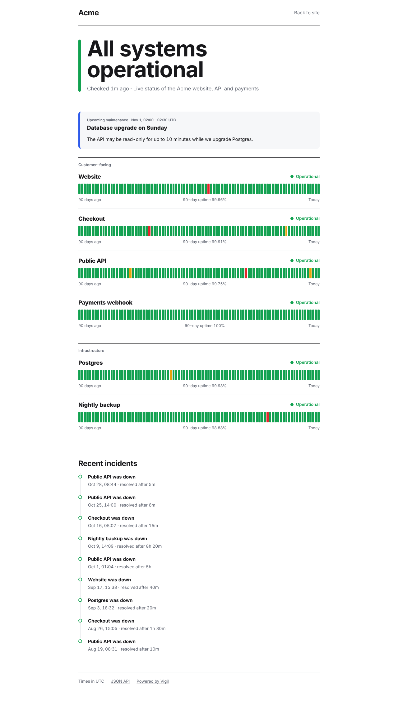
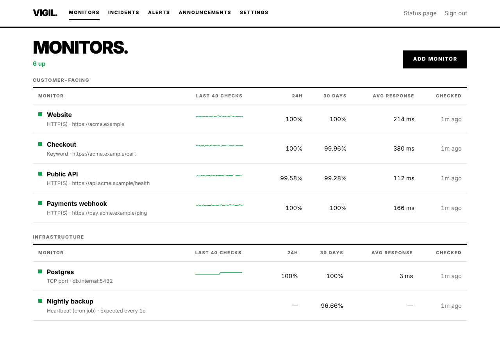

# Vigil

**Self-hosted uptime monitoring and status page.** Watch your websites, APIs, ports and cron jobs, get alerted when something breaks, and give customers a public status page.

PHP 8.2 and SQLite. No Composer packages, no MySQL, no Node. Upload it to any PHP host, or run it with one Docker command.





## Features

**Monitoring**
- **HTTP(S):** status code ranges (`200-299`, `200,301`), redirects, timeouts, GET/HEAD/POST.
- **Keyword:** alert when text is missing from a page, or when text that shouldn't be there appears.
- **TCP port:** databases, mail servers, SSH, game servers.
- **Heartbeat (cron jobs):** your job calls a URL when it finishes, and Vigil alerts you when it doesn't. Jobs can also report their own failure with `/fail`.
- **SSL certificates:** a warning 7, 14 or 30 days before expiry.
- **No false alarms:** a monitor only goes down after N failures in a row, and failing checks are re-run after 20 seconds to confirm quickly.
- **Parallel checks:** HTTP checks run concurrently with `curl_multi`, so 50 monitors take about as long as the slowest one.

**Alerts:** email (SMTP or `mail()`), Telegram, Slack, Discord, ntfy push notifications, and signed JSON webhooks. Each channel has a "Send test" button and a delivery log.

**Status page:** overall state, grouped services, 90-day uptime bars with daily detail, an incident history, and maintenance announcements. It works in light and dark mode and on mobile.

**For developers**
- A JSON API at `/api/status.json`, with CORS enabled.
- README badges for status, uptime and response time:
  ``



## Quick start

### Docker

```bash
git clone https://github.com/wayancc/vigil && cd vigil
docker compose up -d
```

Open `http://localhost:8080/admin`, create your account, and add a monitor. The container runs the checks itself.

### Shared hosting (cPanel, Plesk)

1. Upload the folder and point the domain's document root at `public/`. If your host can't do that (Apache or LiteSpeed), point it at the Vigil folder itself: the included `.htaccess` serves everything from `public/` and hides the rest.
2. Make sure `storage/` is writable by PHP.
3. Open `/admin` and create your account.
4. Add a cron job that runs every minute:
   ```
   * * * * * php /path/to/vigil/bin/vigil run >/dev/null 2>&1
   ```
   **No cron on your host?** The dashboard shows a secret web-cron URL. Point a free scheduler such as cron-job.org at it, every minute.

### VPS

Use `deploy/nginx.conf` and `deploy/vigil-worker.service`. The worker replaces cron and checks every 10 seconds.

### Try it locally

```bash
php bin/vigil serve      # http://127.0.0.1:8000/admin
php bin/vigil work       # in a second terminal, runs the checks
```

## Heartbeats for cron jobs

Each heartbeat monitor gets a secret URL. Call it when your job succeeds:

```bash
0 3 * * * /usr/local/bin/backup.sh && curl -fsS -m 10 https://status.example.com/hb/8f3a…
```

If the call doesn't arrive within the interval plus the grace period, you get an alert. To report a failure straight away:

```bash
curl -fsS "https://status.example.com/hb/8f3a…/fail?msg=disk+full"
```

## Webhook payload

```json
{
  "event": "down",
  "title": "API is down",
  "message": "https://api.example.com/health\nReason: HTTP 503 (expected 200-299)\nSince: 2026-10-28 12:53 UTC",
  "time": "2026-10-28T12:53:18+00:00",
  "link": "https://status.example.com/admin/monitors/3",
  "monitor": { "id": 3, "name": "API", "type": "http", "target": "https://api.example.com/health", "status": "down" }
}
```

`event` is one of `down`, `up`, `ssl` or `test`. Recovery alerts also include `downtime_seconds`. If you set a secret, the body is signed in `X-Wyn-Signature: sha256=<hmac>`.

## Command line

```
php bin/vigil run [--all]        Run due checks once (for cron)
php bin/vigil work [--tick=10]   Check continuously (Docker, systemd)
php bin/vigil status             Show every monitor's state
php bin/vigil test-alert         Send a test to every enabled channel
php bin/vigil user:password --email=you@example.com
php bin/vigil serve              Local dev server
```

## Design

Two looks, switched under **Settings → Look**. Both apply to the dashboard and the public status page.

- **Bold** (default), based on [wayan.cc](https://wayan.cc): black on white, heavy uppercase Inter headlines, square corners and thick rules. Green, red, amber and blue are used only for status, so "up" and "down" can never be confused.
- **Neutral:** quieter type and rounded corners, for teams who want the status page to sit beside their own brand.

Every color, font and border width lives in `public/assets/wyn-tokens.css`. Inter is bundled (SIL Open Font License), so pages make no requests to Google or any other third party.

All CSS classes, data attributes, asset files and database tables use the `wyn-` prefix (`wyn_` in SQL).

## Configuration

Copy `config.example.php` to `config.php` to set the database path, public URL, subfolder, timezone and proxy handling. Everything else (site name, alert channels, SMTP, history retention) is edited in the dashboard.

## How it works

```
cron / worker ──▶ Runner ──▶ Checker (curl_multi, sockets, heartbeat deadlines)
                    │
                    ├─ ok   → status up; resolve incident → "back up" alert
                    └─ fail → count; after N in a row → status down, open incident → "down" alert
                    │
                    └─ checks + daily rollup in SQLite (raw checks pruned after 30 days, daily uptime kept)
```

- A lock file stops overlapping cron runs.
- Uptime percentages round down, so 99.996% shows as 99.99%, never 100%.

## Security

- Passwords are stored with `password_hash`.
- Login is rate limited to 5 attempts per 15 minutes per IP.
- Every admin form has a CSRF token, and session cookies are `HttpOnly` and `SameSite=Lax`.
- Admin pages send `X-Frame-Options: DENY` and `Cache-Control: no-store`.
- Heartbeat and web-cron URLs use random tokens, and the web-cron token can be regenerated.
- `storage/` is blocked from the web.

## Development

```bash
php tests/run.php        # 56 checks, no dependencies, no internet
```

## Roadmap

- [ ] Per-monitor alert routing and quiet hours
- [ ] Response-time alerts ("slower than 2s")
- [ ] Email subscribers for the status page
- [ ] DNS and ICMP ping monitors
- [ ] Multiple users with read-only roles

## License

[GNU AGPL-3.0](LICENSE).

- **Self-hosting:** use, modify and run Vigil for yourself or your company freely, including commercially.
- **Offering a modified Vigil over a network** (for example as a hosted service): you must make your modified source code available to its users. Keeping the “Powered by Vigil” link on the status page pointing at your fork satisfies this for most setups.
